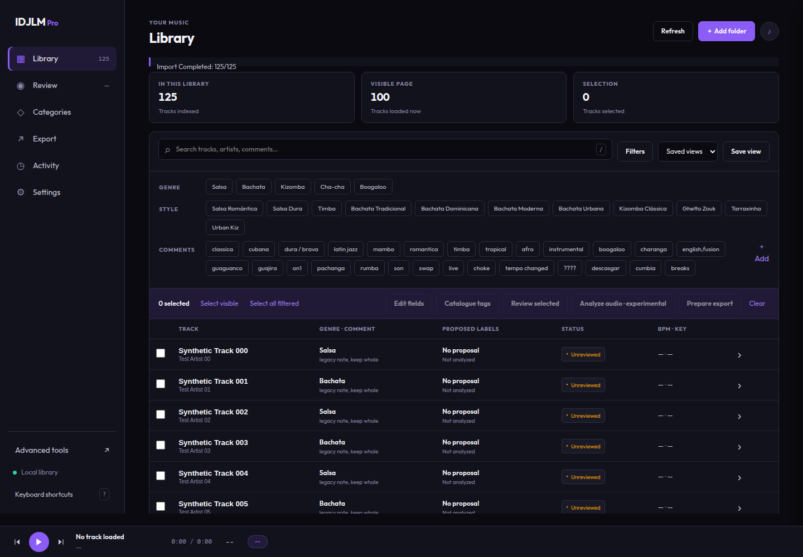

# IDJLM Pro

IDJLM Pro is a desktop app for managing a Latin music library with local import, listening, human review, tagging, and export tools.

## Current review build

The latest public release is [v4.1.0](https://github.com/xonline/idjlm-pro/releases/tag/v4.1.0), published on 1 June 2026. The repository version is 4.2.0, and the new Latin library workflow is in [review PR #44](https://github.com/xonline/idjlm-pro/pull/44). That work is not in a public release yet. The published release will not show the new workspace.

Before you start, install Git, Python 3.11 or 3.12, and Node.js 20 with npm.

To review the new workflow, check out the PR branch:

```bash
git clone --branch feat/latin-library-redesign-implementation https://github.com/xonline/idjlm-pro.git
cd idjlm-pro
npm ci
npm run build
# Use Python 3.11 if 3.12 is unavailable; start.sh reuses this environment.
python3.12 -m venv .venv
./start.sh
```

Open `http://localhost:5050` after the service starts. On macOS Apple Silicon, the source app starts the same way. `start.sh` creates `.venv`, installs the base Python requirements, and starts the local service. The primary Library, Review, Categories, Export, Activity, and Settings workflow does not need a cloud API key.

The [Desktop installer checks workflow](https://github.com/xonline/idjlm-pro/actions/workflows/release.yml) builds review installers for [PR #44](https://github.com/xonline/idjlm-pro/pull/44). Downloadable artifacts are temporary CI review builds, retained for 30 days. They are not public installers. The release workflow still blocks publication because signed and notarized release support is not configured.

To try the Apple Silicon build on an M3 Mac, download the `idjlm-pro-dmg-aarch64-apple-darwin` artifact from the PR run, unzip it, open the DMG, and move the app to Applications. macOS may block this unsigned review build. If it does, follow [Apple’s steps to open an app by overriding security settings](https://support.apple.com/en-au/102445).

## What the review build does



The primary workspace has six pages: Library, Review, Categories, Export, Activity, and Settings. It imports folders without moving the source files, keeps existing metadata, model suggestions, and human decisions distinct, and stores personal tags as literal values. Previewed tag writes keep backups and support guarded restore. Export profiles create staged copies and verify metadata on those copies.

Audio classification runs through an optional local pretrained model. It is experimental. There is no measured Latin-family or fine-style accuracy, no calibrated acceptance threshold, and no 15,000-track performance result. Manual import, review, tagging, and export do not require a cloud API. The earlier metadata-based classifier and other tools remain under Advanced.

A staged copy does not confirm transfer to an iPad or discovery in djay. Physical transfer and destination-app checks remain open.

See the [19 November reliability check](docs/reliability-status-2026-11-19.md), the [implementation status](docs/implementation-status-2026-11-10.md) for prior verification evidence and limits, the [redesign brief](docs/jb-latin-redesign-2026-10-18/README.md) and its engineering and UX specifications for workflow detail, and the [changelog](CHANGELOG.md) for release history.

## Optional local audio model

The base Python environment does not install the audio runtime or model weights. On supported Apple Silicon, install the optional runtime and then download the pinned model from Settings:

```bash
.venv/bin/pip install -r requirements-audio.txt
```

Model download requires an internet connection. Local import, review, metadata writes, and export continue to work without it.

## Development checks

For isolated browser checks with synthetic audio, use a separate verification
environment rather than assuming the application environment includes Playwright:

```bash
python3 -m venv /tmp/idjlm-ui-check
/tmp/idjlm-ui-check/bin/pip install playwright
/tmp/idjlm-ui-check/bin/playwright install chromium
PYTHONDONTWRITEBYTECODE=1 /tmp/idjlm-ui-check/bin/python scripts/verify_latin_ui.py
```

The harness uses a temporary data directory. It does not scan a personal library or download a model. See the [implementation status](docs/implementation-status-2026-11-10.md) for the recorded test results.

The [Codex Cloud pilot guide](docs/CODEX_CLOUD.md) covers isolated repository work in Codex Cloud. Cloud checks do not validate native desktop installers.

## Source map

- `app/routes/` contains Flask routes, including the local `/api/v2` workspace API.
- `app/services/` contains the library store, audio model adapter, tag writer, restore, and staged-copy export.
- `app/static/modules/latin-redesign.js` implements the primary workspace interactions.
- `templates/partials/redesign-shell.html` contains the workspace shell.
- `frontend/main.js` coordinates primary and Advanced workspace startup.
- `src-tauri/` contains the desktop wrapper.
- `tests/` contains route, store, job, model-runtime, writer, and export tests.

Linux source tests do not establish model accuracy on Latin music, performance on an M3 Mac with 16 GB memory, or successful transfer and discovery on an iPad.
