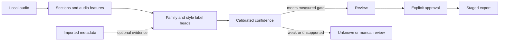

# Latin music classifier redesign

**Verdict:** IDJLM Pro has a useful desktop shell, library workflow, metadata analysis, and SQLite foundation, but the current classifier lacks the audio evidence and evaluation needed to establish reliable fine-grained recognition. It sends text metadata to language models, accepts their labels and confidence at face value, and treats several distinct musical and dance concepts as one genre tree. Rebuild the classification core around audio evidence, a clear multi-axis label system, and measured abstention. Keep the Tauri desktop app, Python sidecar, SQLite, import and preview flow, and export path where their existing behavior is proven. Do not start a UI rewrite or write to a real music library until an audio model passes a representative held-out evaluation.

This plan targets Poy’s M3 MacBook Air with 16 GB of memory and a library of about 15,000 tracks. The default path should work offline after an optional first model download. It should not require Python, Ollama, a paid API, or cloud processing. Prioritize Salsa, then Bachata, then Kizomba. The fourth wave is Cha-cha, Charanga, and Boogaloo. Treat Reggaeton, Bolero, and other styles as later expansion and as useful hard negatives during the first evaluation. Allow “Unknown,” “Mixed,” and “Not supported yet” when audio evidence is weak.

The current working vocabulary comes from OneTagger detailed comments, Mp3tag broad Genre tags, listening, and manually sorted Salsa and Bachata folders. Two existing routes are compatibility baselines: import modified Genre and Comment values into Apple Music, then sync to iPad; or drag whole genre folders directly to iPad from Finder. Keep both available if testing proves they work. Treat them as current workflows, not mandatory permanent complexity. The Music sync transport and receiving iPad container are unconfirmed. Treat existing tags and folders as evidence with different reliability, not as an independent gold standard. Preserve original comment text exactly. Do not assume delimiters from a screenshot or split values such as `english,fusion` without confirming the stored format. Keep existing values unless Poy explicitly approves a batch change. Export a broad standard Genre plus a detailed compatible Comment through a profile that preserves the user’s vocabulary.

## Recommended path for the 15,000-track library

Build an efficient local batch workflow around one resident M3 model worker, persistent jobs, and audio features cached once per verified complete decoded-audio identity. Keep originals and folders in place. Reuse existing human tags as carefully sourced bootstrap evidence, not as the accuracy test. Benchmark local model candidates and the current metadata baseline. Report measured M3 first-run, warm-rescan, and changed-file times before promising an ETA.

Separate newly auto-classified tracks from preserved tags, and report family completion separately from detailed-label completion. A high-confidence Salsa result can remain useful when its style is unknown. Keep a practical review queue, group similar candidates for navigation, preview disputed sections, and require one field-by-field batch diff and one explicit write approval. At 15,000 tracks, 98% precision could still leave roughly 285 errors among 14,250 newly auto-ready predictions, so show classwise error counts and uncertainty. Do not silently call that a completed rollout.

Before interface work, test a simple direct tagged-file route on disposable tracks, then compare richer OneLibrary transfer if Mac djay is available. Use the existing Apple Music and Finder workflows as baselines. Verify that the path ends in usable djay tracks with Genre and Comment visible, searchable, and filterable. Keep the single broad Genre as default. Do not change real tags or folders in this planning phase. If independent verification is unavailable, hold accuracy claims. If a djay route cannot expose required fields, hold that route and test another supported path.

Audit scope: branch `chore/tauri-release-consolidation` at `0d033f7`. The latest public release is v4.1.0 while this branch reports v4.2.0. Public installer publication remains blocked on signing, and an installed M3 workflow has not been tested.

**Planning handoff:** [JB implementation plan](jb-latin-redesign-2026-10-18/README.md) expands this audit into page, module, delivery, and device-test specifications. For future transfer work, its cable-first then validated local-SMB recommendation supersedes this audit’s earlier OneLibrary preference; OneLibrary remains an optional tested route. This audit’s findings and evidence remain unchanged.

## Ranked audit findings

### 1. The classifier does not listen to the recording

**What:** `app/services/classifier.py:19-43` builds prompts from title, artist, existing tags, BPM, key, energy, and optional clave. **Problem:** Those clues can suggest a style, but they cannot establish the identity of unfamiliar or mislabeled audio. The current path does not pass audio embeddings or audio samples to any provider. **Redesign:** Make analyzed audio primary. Use accessible OneTagger comments, Mp3tag Genre values, and user folders as provenance-labeled bootstrap evidence. Measure agreement and reliability before training on them. Keep weak tags separate from predictions. **Consequence:** Existing labels can reduce work, but they do not certify accuracy. Reliable claims still need independent verification.

### 2. Model output is trusted without taxonomy or confidence checks

**What:** `app/services/classifier.py:470-486` copies model-returned genre, subgenre, confidence, and reasoning onto tracks. The review route approves any pending track whose confidence meets the supplied threshold (`app/routes/review_routes.py:78-105`). **Problem:** A response can contain an unknown label or an out-of-range confidence and still become a completed prediction. A model’s own score is not a calibrated probability. **Redesign:** Validate response shape, numeric range, taxonomy membership, and parent-child combinations at the boundary. Store calibrated per-label scores and explicit abstention states. Only enable automatic review for classes whose precision has been measured on held-out data. **Consequence:** Some tracks will remain unclassified or require review. That is safer than silently promoting an invented answer.

### 3. Clave templates cannot support the current genre claims

**What:** `app/services/latin_analyzer.py:13-31` describes two-bar windows as 16 semiquaver steps and defines templates with five and six active hits. It uses a hard-coded onset hop of 2048 at lines 17-25, while the installed librosa call uses a different default. Lines 33-58 resample each window to 16 values without aligning the beat or bar. **Problem:** A flat onset signal deterministically favors the denser 3-2 template. This is neither reliable clave direction nor a genre detector. The route is also separate from the default classification pipeline. **Redesign:** Treat clave as an optional rhythm feature only after testing against expert-labeled audio. Align beat and bar structure, test syncopation and orientation across examples, and allow “uncertain.” Do not tune these templates into a proxy for Salsa, Bachata, or another genre. **Consequence:** The existing clave output must not influence auto-approval until it has an independent benchmark.

### 4. BPM analysis depends on a genre that is not yet known

**What:** `app/services/analyzer.py:578-617` picks BPM correction ranges based on genre and can apply a 0.75 correction. `analyze_track()` passes the proposed or existing genre into analysis at lines 772-789. **Problem:** If the genre is wrong or absent, tempo analysis inherits that error; tempo can then be sent back as evidence for the same genre. A correction that helps one track can damage another. **Redesign:** Preserve the raw tempo estimate and plausible half-time, base-time, and double-time candidates. Choose among them from audio evidence and expose ambiguity. Do not classify genre or subgenre from BPM alone. **Consequence:** BPM remains a useful measured attribute, but its uncertainty and correction history must not masquerade as genre certainty.

### 5. One subgenre field mixes unlike kinds of information

**What:** The default taxonomy centers seven top-level families and cannot represent the requested priority set cleanly. The existing normalizer maps neighboring traditions into broad buckets (`app/services/genre_normalizer.py:6-50`), and the prompt’s fixed genre/subgenre format reinforces that shape (`app/services/classifier.py:55-78`). The canonical default, `taxonomy.json`, uses a `genres` object whose `subgenres` are mappings; templates use the same shape. The editor loops over them as arrays (`app/static/modules/editor.js:127-135`, `app/static/modules/taxonomy.js:199-217`). **Problem:** A fresh install can raise a `.forEach` type error, and newly imported tags can be normalized after SQLite persistence, so the immediate import response can differ from the next database read (`app/routes/import_routes.py:124-155`). Musical identity, a dance style, an arrangement, remix status, language, and a DJ browsing group are not the same property. **Redesign:** Use one validated, versioned schema across storage, API, and UI, and normalize before persistence. Separate music family, style labels, dance suitability, production or remix attributes, and vocal language. **Consequence:** Browsing can stay familiar while labels remain precise. Schema validation must precede any migration or UI work.

### 6. The “learning” loop reinforces approvals, not verified corrections

**What:** Approving a track calls `save_correction()` (`app/routes/review_routes.py:31-42`), and `app/services/learning.py:17-80` records patterns from artist, BPM, and energy. Up to 20 patterns are fed back into future prompts (`learning.py:84-116`). **Problem:** An approval can mean “good enough,” not “expert-verified label.” Repeated patterns can teach a model that an artist or tempo determines genre, then reinforce its own mistakes. **Redesign:** Separate accepted predictions from explicit human corrections. Keep correction records with provenance and allow a curator to mark them as training references. Never use the frozen evaluation set for prompt hints or training. **Consequence:** “Learning” should mean a versioned, auditable update to evidence, not an unmeasured feedback loop.

### 7. Broad tags collapse distinct musical families

**What:** `app/services/genre_normalizer.py:46-49` maps “tropical” and “latin” directly to Salsa. Import currently invokes normalization after writing scanned tracks to the store (`app/routes/import_routes.py:124-155`). **Problem:** Those terms can describe a broad collection or market category, not a specific musical family. Normalizing them as Salsa converts missing information into a confident false label, and the late mutation can make the import response disagree with the next SQLite read. **Redesign:** Preserve source tags as observations. Map only unambiguous spelling variants automatically, normalize before persistence, and retain umbrella tags as broad or unresolved metadata. **Consequence:** Existing library tags remain available to users without becoming ground truth for the classifier.

### 8. Read support is broader than safe tag writing

**What:** The scanner lists MP3, FLAC, WAV, M4A, AAC, OGG, AIFF, and AIF (`app/services/scanner.py:11-12`), while `app/services/tag_writer.py:26-40` opens every target as MP3. The review write route marks success after calling the writer without checking the service’s failure state (`app/routes/review_routes.py:155-173`). **Problem:** A scanned file can fail at write time or appear successful when the writer reports an error. **Redesign:** Implement and validate format-specific writes with truthful per-file status. Write only requested fields, retain unrelated frames, and never convert the audio as a side effect. **Consequence:** Preview and review may support more formats than write-back until each writer passes round-trip checks.

### 9. Current backups do not make “undo everything” dependable

**What:** `tag_writer.py:43-57` backs up only a subset of ID3 tags and allows writing to continue when backup creation fails. `app/services/tag_backup.py:27-42` uses second-resolution IDs. **Problem:** The backup omits fields the writer can change, including BPM, key, subgenre, custom frames, and artwork; two writes within one second can also collide. **Redesign:** Before any write, preserve every changed field and relevant raw frame data under a unique job and file identifier. Stage the write, re-read the result, verify the requested fields, and report success only after verification. Do not overwrite a file that changed outside the job since preview. **Consequence:** No production write path is in scope until backup, recovery, and conflict behavior are proven for each supported format.

### 10. Current accuracy evidence does not cover real classification

**What:** Existing checks are synthetic or mocked for classifier behavior. The targeted test run passed 20 tests in 19.72 seconds. A stored 120-clip synthetic key benchmark reports 93.33% for the current detector, but no representative real-recording genre or subgenre benchmark exists. **Problem:** Key detection on synthetic chords or valid mocked provider responses says nothing about Salsa-versus-Bachata accuracy, remix handling, abstention, or confidence. **Redesign:** Use provenance-labeled library metadata and lawful public datasets for candidate discovery. Establish a frozen, artist- and version-separated final test with independent human verification before making accuracy claims. Engineering must find the source for that verification and report the gap if it cannot. Report classwise errors, coverage, and confidence intervals. **Consequence:** Do not publish an accuracy claim or enable automatic tagging from today’s test results.

### 11. The analysis cache can preserve incomplete or stale results

**What:** `app/services/analysis_cache.py:15-22` omits `energy_timeline` and `phrase_boundaries`. `analyzer.py:759-780` marks restored tracks complete and returns early when `analysis_done` is true. `analysis_cache.py:90-98` hashes only the first megabyte. **Problem:** A cache hit can skip regeneration of omitted fields; edits beyond the first megabyte do not invalidate the cache. **Redesign:** Store all required result fields or mark them unavailable and recompute. Use a complete file checksum and revision for source metadata and write-conflict checks, and a verified complete decoded-audio identity with decoder, preprocessing, encoder, and layer versions for embeddings. A taxonomy or compatible label-head change invalidates predictions and calibration, not matching embeddings; a different encoder invalidates both. Never use a first-megabyte hash or a fuzzy fingerprint as cache identity. **Consequence:** Reanalysis after audio or model-feature changes must be deterministic and must not overwrite human decisions.

## The classification result should describe separate facts

Use a compact result that can represent uncertainty and overlap:

| Axis | Example values | Rule |
|---|---|---|
| Music family | Salsa, Bachata, Kizomba, Other, Unknown, Mixed | Prioritize these three. Add family labels only when examples and boundaries are defined. Keep “Unknown” and “Mixed” distinct. |
| Style | Salsa romántica, dura, timba; Bachata Tradicional, Moderna, Urbana, or Fusion; and defined Kizomba styles | Allow zero or more labels when styles overlap. Each label needs examples and counterexamples. |
| Dance suitability | Salsa room, Bachata sensual, Cha-cha partner dance, uncertain | This describes use on a dance floor, not musical origin. It can be multi-label. |
| Production | Remix, live, acoustic, electronic production, fusion | Record audible or human-confirmed attributes separately from the family. |
| Vocal language | English, Spanish, Haitian Creole, mixed, unknown, not applicable | Record vocal presence separately. Use “unknown” when speech or lyrics are unclear. Do not infer a remix from English lyrics alone. |
| Provenance | Audio model, existing tag, human correction, imported source | Keep observed tags and predicted labels separate. Preserve who or what supplied each value. |

“Bachata influenced / English remix” needs a saved browsing filter, but English vocals alone do not prove a remix or Bachata influence. Original English-language Bachata exists. Confirm remix or edit identity from verified version metadata or reference comparison; otherwise leave version status unknown. The saved category should require an explicit user label or supported audio evidence of Bachata rhythm or influence, English-language evidence, and version evidence. Language detection and dance suitability each need their own confidence and unknown state. Uncertainty on either axis must not block a supported parent genre. “Salsa room” can group Timba, Son, Mambo, and related music for a DJ without claiming those traditions are identical. Keep Kompa and Zouk distinct from Kizomba. Add Douceur and Urban Kiz as dance-use labels only when their definitions and examples are agreed. Charanga belongs in the fourth wave as both a sound or arrangement cue and a browsing label; it can overlap with Salsa or Cha-cha. Its instrumentation is documented by the Library of Congress ([Danzón and charanga](https://blogs.loc.gov/loc/2023/10/dancing-the-danzn-hispanic-heritage-month/)). Boogaloo needs its own recognition and test bucket in that wave ([Latin Boogaloo documentary](https://latinboogaloo.com/about)). The Bachata Sensual organization describes Sensual as a dance style, which supports keeping this axis separate from the music family ([Bachata Sensual history](https://bachatasensual.com/sobre-nosotros/)). UNESCO describes Compas as a Haitian musical genre, supporting a separate Kompa family ([UNESCO: The Compas of Haiti](https://ich.unesco.org/en/RL/the-compas-of-haiti-02273)). These proposed labels are a product ontology for this app, not universal musical definitions.

Every label needs a short definition, positive audio examples, close negative examples, and a decision rule for overlap. For Cha-cha, label musical identity separately from Cha-cha dance suitability. Include hard negatives such as pop at a similar BPM, Son, Mambo, and Bolero. Tempo and clave can support a decision, but neither is sufficient by itself. Keep “Unknown,” “Mixed,” “Other known,” and “Unsupported subgenre” available so users do not have to force a false winner.

## Build the audio evidence before the interface

Preserve the Tauri wrapper, Python sidecar, SQLite, import flow, audio preview, and export foundation. Put analysis behind one local worker so the model is loaded once, memory stays bounded, and jobs can pause, resume, and cancel. The worker should decode the full file, make a cheap pass for silence and section changes, then encode representative sections. Start by testing four to six ten-second sections for models that support that input shape. Test MAEST519 with its published 30-second input. Choose final windows from measured accuracy and speed, then expand analysis only for disputed tracks. Do not rely on the intro or a full-track average alone. Intros, choruses, breakdowns, and medleys can differ. Keep the UI responsive while a job runs.

Keep separate records for imported tags, model predictions, human decisions, and write outcomes. A result should include taxonomy version, model and weight identifiers, feature version, per-axis score, calibrated confidence band, evidence source, and review state. A human correction remains locked when a new model runs. Use explicit states such as unseen, analyzed, proposed, reviewed, write succeeded, and write failed. Keep a complete file checksum and revision as the write-conflict guard. Cache embeddings by verified complete decoded-audio identity plus decoder, preprocessing, encoder, and layer versions. A Genre or Comment-only edit needs a cheap identity check but retains matching embeddings; any audio edit anywhere invalidates them. A compatible label-head or taxonomy change may reuse matching embeddings but must recalculate predictions and calibration. Keep a fingerprint only for duplicate discovery, never cache validity.



Start with a local comparison, not a large training project. Benchmark a permissively licensed CLAP model alongside Essentia’s Discogs MAEST519 genre head and a metadata-only baseline. MAEST519 uses 30-second input and 519 Discogs style classes. Published labels include Bachata, Timba, Cha-Cha, Charanga, Boogaloo, and Compas. They do not include Kizomba, Salsa Romántica, or Salsa Dura, so this head cannot solve the full taxonomy ([MAEST519 metadata](https://essentia.upf.edu/models/classification-heads/genre_discogs519/genre_discogs519-discogs-maest-30s-pw-519l-1.json)). Compare EffNet400 only as a speed baseline. Its published classes omit Bachata, Timba, and Kizomba ([EffNet400 metadata](https://essentia.upf.edu/models/classification-heads/genre_discogs400/genre_discogs400-discogs-effnet-1.json)). Compare total M3 time and quality. Do not assume the larger head wins. Essentia model weights use CC BY-NC-ND 4.0 for non-commercial use, with proprietary licenses available. Keep them comparison-only until the exact artifact and use rights are cleared. Do not download, purchase, or ship candidates in this plan ([Essentia licensing](https://essentia.upf.edu/licensing_information.html)).

CLAP remains a useful baseline because its model card describes music-and-speech audio/text representations and lists Apache 2.0 for that model artifact ([LAION larger CLAP model card](https://huggingface.co/laion/larger_clap_music_and_speech)). Candidate scores rank labels. They are not calibrated probabilities. Compare frozen audio embeddings with a small regularized classifier, and add rhythm features only if they improve held-out results. General music models do not establish niche Latin subgenre accuracy.

## Make 15,000 tracks operationally practical

Treat this as an end-to-end batch job, not 15,000 separate prompts or review clicks. Inventory files in place. Do not move music or alter folders during classification. Use a persistent queue and one resident local model worker so the model loads once. Cache audio features once per verified complete decoded-audio identity and reuse them across compatible family, style, rhythm, and language heads. Scan the whole recording cheaply for silence and section changes, encode representative windows, and expand only when heads disagree or a result is uncertain. Do not share a prediction across remixes, live versions, speed edits, medleys, or other files just because titles or perceptual fingerprints look similar. Reuse features only after verifying identical audio, never from a first-megabyte hash or fuzzy fingerprint.

Do not call an LLM once per song. Model comparison should run locally. Metadata lookup can be optional, batched, cached, and explicitly enabled. The default classification path must not depend on paid or cloud APIs. A first inventory and analysis run has a different cost from a later run: unchanged files should reuse verified cached features, and only changed or new files should return to decoding and inference. A Genre or Comment-only change should perform a cheap full-identity check and keep matching embeddings; an audio change anywhere must decode and infer again. Benchmark cold first-run time, warm same-library scan, changed-file scan, memory, interruption recovery, and actual ETA on the M3 at 100, 1,000, and 15,000 tracks. Report measured estimates from those runs. Do not promise a one-hour or overnight completion before measuring.

Present clear result groups: **Ready in bulk**, **Needs review**, **Preserved existing**, and **Failed**. Report preserved human-tagged tracks separately from newly auto-classified tracks. Report parent-family completion separately from detailed-label completion. Do not count preserved values toward new automation coverage or hide unsupported tracks from the denominator. A confident family prediction can be ready even when its subgenre is unknown. An unresolved subgenre must not erase or block a reliable broad Genre. Group similar review candidates to save navigation time, but make each selected track and proposed field explicit. A listener may preview a representative example, but must not approve the entire group from that example alone. Play only disputed sections when the evidence narrows the issue to a section. Show one batch field diff and ask for one explicit write approval for the selected batch, rather than requiring one click per song.

Measure automation coverage and residual review together. A 70% gate leaves 4,500 of 15,000 tracks for manual review. A proposed 95% target leaves up to 750 if all tracks are eligible and accuracy gates hold. Neither number is measured. At 14,250 newly auto-ready tracks, 98% precision still means about 285 errors. This arithmetic illustrates possible scale. It is not a forecast. Report classwise errors and uncertainty, new automation coverage, preserved tags, family completion, detailed-label completion, unsupported tracks, remaining review count, and review minutes. Treat 98% as an early research gate, not product signoff. Signoff must retain required precision as the queue shrinks. Stop and improve the model or narrow supported scope if the workload remains impractical. Do not assign thousands of listens to Poy. Review grouping saves navigation, not evidence. It never proves every grouped track shares a label.

## Build a trustworthy evaluation set from available evidence

The engineering task is to discover lawful, usable existing datasets and the project’s accessible OneTagger comments, Mp3tag Genre tags, and manual folder organization. First inspect what fields and values are actually present. Treat palette entries as vocabulary only, not as assigned track labels. Preserve source and confidence for each imported label. Use stable, specific tags and verified human corrections as candidate bootstrap labels; hold broad, inconsistent, machine-generated, or ambiguous tags out of training until reviewed. MTG-Jamendo offers over 55,000 uploader-tagged tracks, instrument labels, and per-track audio licenses. Its classes are broader than this taxonomy. Consider it for instrument cues or negatives only after checking its repository terms, each track license, and the intended use ([MTG-Jamendo dataset and terms](https://github.com/MTG/mtg-jamendo-dataset)). Never claim independent expert verification from tags used to fit the model. Do not invent labels to fill a benchmark.

Build corpus cleaning, label mapping, deduplication, grouped splits, and evaluation tooling as part of the implementation. Keep a small, fixed, representative audit sample for independent expert review and adjudication. The engineering team must find a practical source for this verification and report the remaining evidence gap. Poy may answer a short optional taxonomy preference question, but he is not responsible for sourcing or manually labeling a large corpus. Expert verification remains necessary before accuracy claims or auto-write decisions.

Start diagnosis with available recordings covering Salsa, Bachata, and Kizomba, plus Cha-cha, Charanga, and Boogaloo fourth-wave examples. Include Reggaeton, Bolero, other known styles, and close cross-family examples as hard negatives. Dataset counts must follow what lawful, representative data and independent verification make possible. They are not a request for Poy to assemble or label a corpus.

Split by artist, album, original recording, and remix/version before training. No excerpt from one recording may appear in more than one split. Keep train, grouped development, calibration, and frozen final-test groups separate. Select the model and features on development data. Set thresholds on calibration data. Evaluate the frozen test once after selection. Reserve unseen artists, eras, versions, and low-quality recordings. Include non-target music and close negatives. The final test must never supply training labels, prompt hints, thresholds, or taxonomy tuning. Artist-separated evaluation is important because a model can otherwise memorize artist or production cues. The MIREX audio-classification task describes a train/test setup intended to measure generalization ([MIREX Audio Classification train/test tasks](https://www.music-ir.org/mirex/wiki/2016:Audio_Classification_(Train/Test)_Tasks)).

## Targets for a supported first release

These are proposed research and product gates. They are not measured results or promises. The 98% precision value is an early research gate, not evidence that a 15,000-track rollout is safe. Product signoff must show classwise measured errors and uncertainty, new automation coverage, unsupported share, preserved human tags, parent-family and detailed-label completion separately, and residual review minutes. A rounded precision on ten examples does not certify a rare class.

| Measure | Proposed gate |
|---|---|
| Core family classification | Macro F1 of at least 0.90 on Salsa, Bachata, and Kizomba, with per-family precision, recall, confusion matrix, and 95% confidence intervals shown. |
| Early automatic-review research gate | At least 98% point precision overall and 95% for each enabled core family, with one-sided 95% lower bounds shown. This does not by itself qualify a 15,000-track product rollout. Proposed workload target: at least 95% of eligible core-family tracks auto-ready without lowering the measured precision gate. |
| Supported subgenre | End-to-end macro F1 of at least 0.85, counting parent-family routing failures. The auto-ready subset needs at least 95% precision and a one-sided 95% lower bound of 90%. Do not certify a class with fewer than 100 labelled held-out examples. |
| Fourth-wave recognition | Measure Cha-cha, Charanga, and Boogaloo as separate recognition buckets, including cross-family overlaps and adjudicated hard negatives. Use the same minimum held-out count and lower-bound rule. |
| Cha-cha identity and suitability | No more than 2% false positives for both the music identity and dance-suitability labels on adjudicated hard negatives, including similar-tempo pop, Son, Mambo, and Bolero. Report the sample count and confidence interval. |
| Confidence | Calibrated per class and axis. Measure reliability on calibration data and freeze thresholds before the final test. |
| User trust | Show why a track needs review, what evidence is available, and what the user confirmed. Measure review time and correction rate alongside accuracy. |
| Review workload | Report new automation separately from preserved tags. Report parent-family and detailed-label completion separately, plus unsupported count, actual residual review count, grouped-review time, total review minutes, and 15,000-track coverage. If the residual queue is impractical, stop and improve the solution instead of shifting mass manual review to Poy. |
| M3 performance | Keep the analysis worker under a proposed 4 GB memory ceiling and the UI responsive. Measure cold, warm, and changed-file scans at 100, 1,000, and 15,000 tracks. Measure CPU first. Test Apple Metal only after correctness matches CPU. |

Report precision-recall curves, auto-ready coverage, and residual review workload together. A high-precision system that leaves thousands of tracks for manual review fails the efficiency requirement, even if its F1 looks good. Do not lower precision to improve coverage. Do not ship automatic file writes as a consequence of model confidence. Preserve explicit batch field review and write approval as separate safeguards.

## Phases and stop gates

| Phase | Deliverable | Exit gate |
|---|---|---|
| 0. Map workflow and evidence | Inspect tags and folders, discover lawful datasets, set provenance rules, and test a simple tagged-file export plus OneLibrary if Mac djay is available. | Verify initial import, retagging, Genre and Comment display/search/filter, and usability in djay. Treat Apple Music sync and Finder folder transfer as optional compatibility baselines. No real tags or folders change. |
| 1. Prove Salsa audio value | Small local prototype comparing CLAP and MAEST519 baselines with frozen embeddings. No production UI or file writes. | On grouped development artists and versions, audio improves the metadata baseline for Salsa family and the three selected Salsa styles against Salsa-adjacent and other-family negatives. Freeze the result, then evaluate once on the final test. |
| 2. Add Bachata and Kizomba | Repeat the corpus, baseline, calibration, and abstention work for Bachata, then Kizomba. | Each added family meets its measured gate. Keep other labels manual. |
| 3. Integrate shadow review | One local worker, persistent jobs, evidence view, schema migration, and predictions stored beside the current library. | Initial import and retagging already-imported tracks both work. No existing tags or human decisions are overwritten. Migrations preserve originals and have recovery checks. |
| 4. Add safe write-back | Format-specific writers, full backups, conflict detection, read-after-write verification, and truthful per-file status. | Round-trip and recovery checks pass for every enabled format. Test against disposable copies only. A batch field diff and a single explicit write approval cover the selected scope. |
| 5. Validate on the target machine | Offline install, model download, interruption recovery, and 100-, 1,000-, then 15,000-track performance stages after correctness. | The UI stays usable, cache invalidation works, failed jobs resume safely, measured ETA and review workload are acceptable, and accuracy gates still hold. |

The first decision gate is Phase 1. Do not spend time on a new classification interface until the candidate model proves Salsa value. Add Bachata, then Kizomba, before the fourth wave of Cha-cha, Charanga, and Boogaloo. Lawful representative data and an independent verification source remain dependencies for accuracy claims. The initial M3 benchmark supplies a measured ETA before any full-library promise.

## Areas likely to change later

Keep implementation focused on the paths that own the current failure modes:

| Area | Likely modules | Later work |
|---|---|---|
| Audio evidence and prediction | `app/services/classifier.py`, `app/services/analyzer.py`, `app/services/latin_analyzer.py` | Add local audio model worker, validated structured outputs, independent tempo candidates, and tested rhythm evidence. |
| Identity and cache | `app/models/track.py`, `app/services/track_store.py`, `app/services/analysis_cache.py` | Store immutable source identity, versioned predictions, human locks, and complete cache entries. |
| Taxonomy | `taxonomy.json`, `app/data/taxonomy_templates.json`, taxonomy routes, taxonomy UI modules | Define and validate one versioned multi-axis schema across persistence, API, and UI. |
| Review and feedback | `app/routes/review_routes.py`, `app/services/learning.py` | Separate acceptance from correction, show evidence, and keep curated training references out of the frozen test set. |
| File operations | `app/services/scanner.py`, `app/services/tag_writer.py`, `app/services/tag_backup.py` | Add format-aware write capability, complete backups, conflict checks, and verified status. |
| Desktop packaging and evidence | `src-tauri/`, build configuration, focused tests and fixtures | Package a redistributable model only after license review; validate offline install and target-machine limits. |

The first user experience can remain three views: Library, Review, and Categories. Public Tagami feature descriptions offer useful interaction patterns: keyboard genre and comment tagging, inline and bulk edits, stacked filters and saved presets, waveform preview, staged metadata review, and tag lookup. Borrow keyboard accept-and-next, multi-axis tags, stacked filters with a saved “Bachata influenced / English remix” preset, playback of evidence sections, and a field-by-field diff before save. These are product patterns only; they do not establish Tagami’s genre accuracy or reveal its private algorithm. The installed skill lists did not contain REA, so this plan does not rely on it. Prototype only the supported playlist or category export needed to prove djay browsing; defer artwork generation and cue transfer until classification is proven. See [Tagami’s public feature page](https://tagami.au/).

Show family, style, dance suitability, language, status, and provenance in the Library. In Review, preview the original Genre and Comment beside proposed values and play disputed sections. Keep OneTagger’s detailed Comment values and Mp3tag’s broad Genre workflow compatible through a lossless, user-reviewed mapping. Do not rewrite current values unless Poy approves the selected batch. Show one diff for selected fields and require one approval for that batch.

| Transfer route | Role in the plan | What to verify |
|---|---|---|
| Direct tagged-file export | Recommended first test because it keeps the path simple. Export approved files or copies and preserve source files and references. | Import new and retag already imported disposable files through the iPad route Poy uses. Check Genre and Comment display, search, and filters in djay. Do not assume a specific receiving container. |
| OneLibrary | Preferred richer option if Mac djay and a supported USB path are available. Mac djay exports playlists and library data to USB. On iOS, djay can browse USB or import a playlist and copy files to internal storage. OneLibrary is read-only on iOS. Cue and playlist support does not prove Genre or Comment mapping ([djay Pro for Mac OneLibrary](https://help.algoriddim.com/user-manual/djay-pro-mac/music-library/advanced/onelibrary), [djay for iOS OneLibrary](https://help.algoriddim.com/user-manual/djay-ios/music-library/advanced/onelibrary)). No purchase is required for this plan. | Test initial transfer and retagged files. Check Genre and Comment display, search, and filters. Do not write private djay database or OneLibrary files, or promise automatic transfer. |
| Existing Apple Music and Finder routes | Compatibility baselines. Keep them if disposable tests confirm they work. They need not become permanent export systems. | For Apple Music, trace the source file versus any managed copy, Music database update, sync transport, and djay library result. Test import, retag of an already imported file, and sync. Algoriddim staff report that Local Music reads the Music database rather than raw ID3, so check that view separately ([djay forum report](https://community.algoriddim.com/t/read-multiple-genre-tags-in-local-music/42053)). For Finder, test whole-folder transfer and retagging a transferred file without assuming the iPad container. Check Genre and Comment display, search, and filters for both routes. Do not write to private djay databases. |

If a route cannot surface or filter Comments reliably, keep detailed labels in IDJLM and use only a tested alternative export path. Do not claim custom tags or M3U works without verification. Keep one stable media copy. Where the destination supports it, store multiple styles as category membership rather than duplicating audio into every subgenre. A folder fallback places each track in one user-chosen broad-genre location and keeps detailed styles in the catalogue and tags. Before export, show source count, new and changed files, source and target bytes, existing target size, and free space. Export incrementally with a manifest of file identity, tag version, and destination state, so unchanged files are not rewritten or copied. Do not assume Finder supplies a safe automated delta-sync API. Keep original folders unchanged. In Categories, show definitions and examples so users can extend labels consistently. A new label in a menu does not teach a model; it must pass the same data and evaluation gates.

## Scope and next action

This document specifies a redesign only. It does not change code, taxonomy data, user settings, model downloads, music files, or folders. It does not measure accuracy, M3 performance, an iPad/djay transfer, or real-audio results. It does not choose a licensed model for a future paid release. It preserves the existing desktop foundation while making classification correctness and practical 15,000-track processing the product priority.

When Poy requests implementation, the first engineering milestone is a scoped evidence and compatibility spike: inventory accessible tags without changing them, identify lawful candidate datasets, benchmark the local model baselines, and test a direct tagged-file export into djay. If Mac djay is available, compare OneLibrary. Test Apple Music and Finder as existing-workflow baselines. Report measured M3 timings, the routes’ Genre and Comment display/search/filter behavior, independent-label availability, and the remaining accuracy gap. These are implementation evidence tasks, not prerequisites for this plan and not a request for Poy to mass-label music or supply a corpus.

Deferred implementation is tracked in [xonline/jobs #879](https://github.com/xonline/jobs/issues/879). It remains human-gated until Poy requests implementation. The scoped evidence and compatibility spike, including the prototype benchmark, is the first implementation work; it must finish before any new classification UI release or production tag writes. It has no user-supplied mass-labeling or corpus prerequisite. The solution must reduce manual review to a measured, practical residual queue rather than assign Poy thousands of listening decisions.

## Verification notes

The bounded, no-write check passed:

```bash
rtk env PYTHONDONTWRITEBYTECODE=1 XDG_CACHE_HOME=/tmp/idjlm-audit-xdg pytest -q -p no:cacheprovider tests/test_classifier.py::TestClassifier::test_classify_tracks_partial_batch_salvage tests/test_classifier.py::TestClassifier::test_classify_tracks_partial_then_malformed_sets_correct_error tests/test_analysis_correctness.py
```

Output: `20 passed in 19.72s`.

Two isolated reproductions support the BPM and clave findings. `_apply_bpm_correction(120, None)` returns `(90.0, True)`, because an unknown genre uses the 75–110 BPM default range and accepts the 0.75 candidate. `librosa.onset.onset_strength()` delegates to a mel-spectrogram feature whose installed default is `hop_length=512`, while `latin_analyzer.py` assumes 2048. These are implementation findings, not accuracy measurements.
